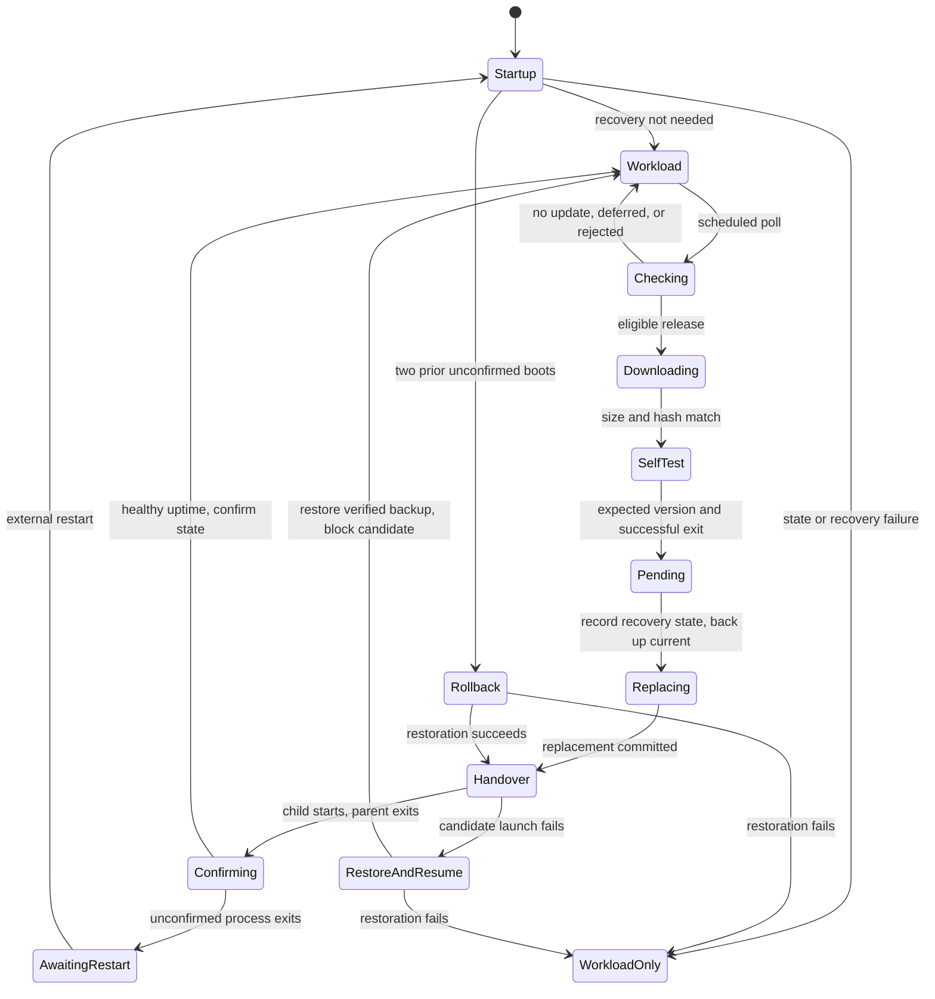

# Product Requirements: Self-Updating Client

| Field | Value |
| --- | --- |
| Authors | Rajini Passikanti, Codex, Claude |
| Updated | October 28, 2026 |
| Status | Implemented assessment submission; platform acceptance depends on the submitted commit's CI results |
| Components | `app`, `update-server`, `release` |

## 1. Purpose

Provide a deployed command-line application that discovers a newer release, authenticates it, replaces its executable, and resumes its workload without a manual reinstall. The implementation includes the client, release-signing tools, and the server needed to distribute updates.

This specification translates the assessment into explicit product and engineering choices. The supplied challenge asks for self-updating behavior, production-quality judgment, reasonable Windows/macOS/Linux support, required server components, and documented answers to ambiguous questions. It permits LLM assistance and expects the candidate to explain and extend the submission live. The numbered requirements below are this project's implementation contract.

## 2. Goals and scope

| Goal | Outcome |
| --- | --- |
| G1 — Automatic delivery | A running client detects and installs an eligible newer version without user intervention. |
| G2 — Authenticated execution | Update candidates must authenticate against an embedded trusted release key before execution. |
| G3 — Recoverable failure | Verification failures preserve the workload; installation and handover retain a fallback and recovery state. |
| G4 — Portability | One codebase targets Windows/amd64, macOS/amd64 and arm64, and Linux/amd64 and arm64. |
| G5 — Operability | Releases can be built, signed, published, inspected, refreshed, and halted with documented commands. |

The workload is a heartbeat that demonstrates process continuity. Versioned multi-file applications, administrative installers, graphical UI, an external supervisor, OS code signing/notarization, fleet telemetry, staged rollout, and delta/resumable downloads are outside this submission's scope.

## 3. Users

- **Application user:** runs the application from a writable per-user installation.
- **Release engineer:** builds and signs trusted binaries, then publishes a complete version.
- **Operator:** runs the update server, monitors release status and logs, and handles failed deployments or damaged installations.

## 4. Clarifying questions and assumptions

| Question | Working answer |
| --- | --- |
| Are updates silent or user-approved? | Silent. The heartbeat workload stops before handover. An optional library hook can defer non-mandatory updates. |
| Is the network or update server trusted? | Release integrity comes from signatures. HTTPS is required except on loopback. The server has no release-signing private key. |
| Where is the application installed? | A per-user writable directory containing one executable. Its state directory must also be writable. |
| What is the update latency? | Default checks every five minutes, with jitter and backoff. Demo/test intervals are shorter. |
| Are downgrades allowed? | Server-offered versions must be strictly newer. Local recovery can restore a previous version after an unconfirmed update; operators otherwise fix forward with a higher version. |
| Can clients remain offline? | Yes. They can accept the latest eligible release on reconnect if its signature, expiry, and embedded-key compatibility still hold. |
| Is the local administrator trusted? | Yes. Protecting against an administrator replacing binaries or deleting state is outside scope. |
| Are channels isolated security domains? | No. Routing supports separate channel manifests, but channel membership is not signed. Percentage rollout is future work. |
| Who restarts a crashed client? | A user or external service manager. The repository does not supply a supervisor. Recovery requires a later launch reaching updater startup. |
| Can processes overlap? | Application lifetimes are serialized by `app.lock`; installation operations share `update.lock`. All instances must use the same state directory. |
| Can releases be published concurrently? | Publish and refresh share a release-directory lock. A competing operation fails explicitly and may be retried. |
| How are builds promoted? | A version's complete artifact set is immutable across channels. Promotion reuses identical bytes; changed content requires a new version. |
| Is OS signing required? | Not for this submission. Authenticode, notarization, installers, and application bundles are future integration work. |
| What language and dependencies are used? | Go standard library, cgo-disabled release binaries, and a Go 1.22 source baseline. Use a current supported Go toolchain for development and modern operating systems. |

## 5. Functional requirements

### Client

| ID | Requirement |
| --- | --- |
| FR-1 | Acquire the application lifetime lock, then perform startup recovery and temporary-file cleanup under the installation lock. |
| FR-2 | Poll the manifest endpoint with channel, current version, OS, architecture, and a random stable installation ID. Apply ±20% jitter and bounded exponential backoff on errors. |
| FR-3 | Cap the envelope at 64 KiB, verify its Ed25519 signature, then parse and validate the exact authenticated payload bytes. |
| FR-4 | Accept only a version strictly newer than the running version and high-water mark, unexpired, unrevoked, unblocked, and available for the current platform. Reject stale executable identities. |
| FR-5 | Defer additional installations while any update is pending confirmation or recovery, preserving the existing fallback. |
| FR-6 | Allow an optional `ShouldApply` hook to defer a non-mandatory update. `min_version` or revocation of the running version overrides the hook, but does not bypass pending-update safety. |
| FR-7 | Stream downloads into an exclusive temporary file beside the resolved executable, enforcing signed size and SHA-256 before execution. |
| FR-8 | Run the candidate's `--self-test` within ten seconds. Require successful exit and `self-test ok <version>`. Skip a failed candidate for the rest of that process's run. |
| FR-9 | Persist pending state with candidate/previous versions and digests; preserve permissions, back up the current executable as `.prev`, and replace the install path using platform-specific operations. |
| FR-10 | Report whether replacement committed separately from any durability error. Preserve pending recovery state when replacement has committed or the original executable cannot be verified intact. |
| FR-11 | Stop the workload, verify the candidate at handover, launch it with the same arguments/environment, and exit the parent. The new instance waits for the parent's lifetime lock. |
| FR-12 | On handover launch failure, attempt verified backup restoration and resume the existing workload. After successful restoration, block the failed candidate and clear pending state. If recovery fails, disable automatic updates until repair and restart. |
| FR-13 | Confirm a version after configured healthy uptime, then advance the high-water mark and clear its matching pending marker under the installation lock. |
| FR-14 | After two unconfirmed boots, attempt rollback on the next external launch that reaches startup. Block the failed version after successful restoration. Failed restoration must not request automatic relaunch. |
| FR-15 | Preserve unreadable or malformed state and report an error instead of resetting it. Missing state initializes a new installation. |
| FR-16 | Expose `--version`, `--self-test`, `--server`/`UPDATER_SERVER`, `--channel`, `--interval`, `--healthy-after`, `--heartbeat`, and `--state-dir`. |

### Server and publishing

| ID | Requirement |
| --- | --- |
| FR-17 | Serve signed channel manifests at `GET /v1/manifest` with `no-store`; return 404 when the channel has no published release. |
| FR-18 | Serve immutable artifacts at `GET /v1/artifacts/{version}/{file}` and reject invalid/traversal paths. |
| FR-19 | Provide `GET /healthz`, `GET /status`, structured request logs, bounded HTTP timeouts, configurable listen address/TLS files, and graceful shutdown. |
| FR-20 | Generate Ed25519 key pairs without overwriting existing keys. Create the private file with mode 0600; Windows protection also depends on directory ACLs. |
| FR-21 | Stage and hash matching `app-<os>-<arch>` artifacts, validate/sign metadata, commit the complete artifact directory, then publish the current manifest atomically. |
| FR-22 | Reject non-newer versions and versions previously published on the same channel. Record each published manifest in channel history. |
| FR-23 | Preserve global version immutability. An existing version can be promoted only when artifact names, sizes, and digests all match. Serialize publish and refresh with the same lock. |
| FR-24 | Refresh expiry only after verifying the current signature and matching its artifacts against their recorded digests. |
| FR-25 | Cross-build all five supported release targets with version and public-key ring embedded at build time. |

## 6. Security contract

The trust root is the build-time public-key ring. The signing tool reads a private key file; the update server receives only public release content. KMS/HSM integration is future work.

The envelope is JSON:

```json
{ "key_id": "k1", "payload": "<base64 payload bytes>", "sig": "<base64 signature>" }
```

The signature covers `"nametag-updater-manifest-v1\n" || payload_bytes`. The unsigned `key_id` selects a trusted verification key. The client validates the signature before interpreting the payload; unknown payload fields are ignored for forward compatibility.

The payload contains `version`, `released_at`, `expires_at`, optional `min_version` and `revoked`, and a platform-to-artifact map. Each artifact has a same-origin path under `/v1/artifacts/`, signed size, and SHA-256. Versions use strict numeric `MAJOR.MINOR.PATCH` ordering.

Controls reject unsigned or modified releases, invalid artifact paths, size/hash mismatches, expired manifests, and versions at or below the client's version floor. Redirects must preserve scheme and host. Missing embedded keys prevent normal startup and fail the candidate self-test.

Security boundaries:

- A compromised server can withhold releases or substitute an eligible, unexpired historical release signed by a trusted key. The protocol does not prove that an offered release is the latest.
- Channel membership is not authenticated. A signed beta release can be offered to a stable client that trusts its signing key.
- Expiry depends on the client clock. A replayable signed timestamp alone would not establish freshness.
- Local administrators are trusted; deleting state weakens replay and recovery protection.
- A compromised trusted signing key can authorize malicious code. Release-based rotation does not immediately revoke trust on offline clients.

## 7. Lifecycle and failure handling



`WorkloadOnly` keeps the existing process alive with automatic updates disabled until operator repair and restart. A stale process exits without modifying a replacement.

| Failure | Behavior |
| --- | --- |
| Network error, timeout, or server error | Continue workload; log and retry with backoff. |
| Invalid signature, manifest, artifact, or self-test | Reject candidate; preserve current executable and workload. |
| Release at/below version floor | Treat as up to date; debug log. |
| Pending update | Defer all further installs until confirmation or recovery. |
| Installation error before replacement | Clear pending state only if the original executable is verified intact; retain recovery information otherwise. |
| Unix rename commits, directory sync fails | Preserve pending state, report the durability error, and proceed to handover. Persistence remains uncertain. |
| Handover launch fails | Attempt verified backup restoration; resume workload. Disable updates if recovery also fails. |
| Rollback backup missing, changed, or inaccessible | Preserve recovery state, report failure, and keep workload alive without an automatic restart loop. |
| State read/parse failure | Preserve the file and fail the mutation. Startup failure disables automatic updates while retaining the workload. |

On Unix, the executable swap is one rename followed by directory synchronization. Windows uses two renames with bounded retry and attempted restoration if the second fails. Power loss between those renames can leave the install path missing; external repair is required because the app cannot run its own cleanup without its executable.

## 8. Non-functional requirements

| Area | Requirement and boundary |
| --- | --- |
| Durability | Flush downloaded content and atomic file writes. Synchronize Unix directory entries. Windows directory synchronization is a no-op; no universal power-loss guarantee is claimed. |
| Concurrency | Protect every installation mutation with the same OS lock. Serialize app lifetimes and reject stale identities. Release OS locks automatically on process exit. |
| Resource bounds | Cap manifests, enforce signed download sizes, bound request/self-test times, and jitter polling. |
| Observability | Structured logs identify versions, transitions, and errors where applicable. `Reporter` is an optional library integration; no telemetry backend is configured. |
| Maintainability | Small packages with explicit responsibilities and OS-specific files behind build tags. |
| Compatibility | Standalone executable releases for the five target OS/architecture combinations. Tests use current supported toolchains; Linux also checks the Go 1.22 source baseline. |

## 9. Acceptance and validation

These are observable acceptance conditions. Local evidence does not substitute for the submitted commit's three-OS CI results.

| ID | Acceptance condition | Verification |
| --- | --- | --- |
| AC-1 | A running 1.0.0 client installs, launches, and confirms 1.1.0. | Real-binary end-to-end test and local demo. Test waits are bounded at 60 seconds; production latency depends on polling, download, and startup time. |
| AC-2 | Invalid signatures, ineligible releases, invalid downloads, and failed self-tests leave the current install unchanged. | Manifest and updater tests; broken-release end-to-end test. |
| AC-3 | A pending release cannot overwrite the healthy fallback through a second update. | Rapid-release regression test. |
| AC-4 | Conflicting publications cannot change an existing version; identical cross-channel promotion succeeds. | Immutable-promotion and concurrent-publisher tests. |
| AC-5 | Installation state mutations honor locks, and stale processes cannot reinstall or confirm a replacement. | Process-lock, startup-contention, lifetime-lock, and stale-process tests. |
| AC-6 | Failed rollback does not request relaunch or enter an automatic restart loop. | Missing/changed-backup unit tests and real-binary missing-backup test. |
| AC-7 | A committed swap error retains pending recovery information and preserves the fallback. | Injected post-commit error regression test. |
| AC-8 | Failed handover restores the verified backup and blocks the candidate, or reports operator recovery required while preserving state. | Handover failure and failed-recovery tests. |
| AC-9 | External restarts after two unconfirmed boots restore and run the previous version. | End-to-end test kills and externally restarts the actual candidate. |
| AC-10 | Invalid local state remains unchanged and cannot drive installation or confirmation. | Malformed-state preservation tests, including invalid pending state. |
| AC-11 | Formatting, vet, pinned Staticcheck, tests, and all five target builds pass. | Local checks and CI workflow. |

Tests create disposable keys, local servers, and temporary installations. Recovery-checkpoint tests copy files after successful steps and use dummy executables with an injected self-test. They cover state transitions, not loss of unflushed data. Real-process restart tests provide separate process-level recovery evidence. Interruption between Windows renames and actual power-loss persistence remain outside verified coverage.

The documented validation commands are in [README.md](README.md#validation). Local macOS/arm64 validation on October 28, 2026 includes the race-enabled suite, vet, lint, five target builds, and the demo. The current [CI workflow](.github/workflows/ci.yml) runs on Ubuntu, macOS, and Windows; acceptance on those systems requires green results for the submitted commit.

## 10. Operational readiness and future work

The [runbook](RUNBOOK.md) provides release promotion, rollout halt, manifest refresh, signing-key rotation, update-failure diagnosis, and manual recovery procedures. Server status reports release metadata, not client adoption or health telemetry.

The principal deployment limits are external crash supervision, the Windows rename gap, uptime-only health, clock-dependent expiry, and operator recovery for damaged state/backups. These are explicit tradeoffs of the single-executable design.

Future work, in priority order:

1. A stable launcher and versioned installations for stronger interruption recovery and independent health supervision.
2. Authenticated channel binding and a root-key hierarchy for controlled signing-key delegation/revocation.
3. Application readiness probes and fleet telemetry to support staged rollout and automatic rollout halt.
4. OS signing/notarization, installers, resumable downloads, and delta updates as deployment needs justify them.
