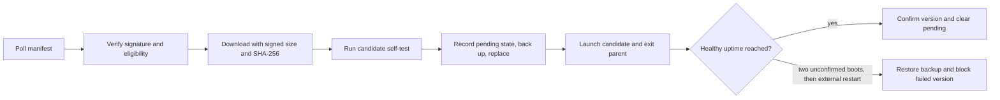

# Nametag Updater

A self-updating command-line application for Windows, macOS, and Linux. A running client polls an update server, verifies a signed release, replaces its executable, and starts the new version. A heartbeat represents the application's normal workload.

The implementation uses the Go standard library. Release binaries are built with cgo disabled; no third-party runtime dependencies are required.

| Component | Responsibility |
| --- | --- |
| [`cmd/app`](cmd/app) | Workload, update checks, installation, health confirmation, and recovery |
| [`cmd/update-server`](cmd/update-server) | HTTP endpoints for manifests, artifacts, health, and release status |
| [`cmd/release`](cmd/release) | Signing-key generation, immutable publication, and manifest refresh |

[PRD.md](PRD.md) records requirements, assumptions, and acceptance criteria. [RUNBOOK.md](RUNBOOK.md) covers publishing, rollout incidents, key rotation, and manual recovery.

## Terminal walkthrough

This recording shows a fresh clone running `make demo`, the live update from 1.0.0 to 1.1.0, and verification of the installed version and confirmed state.


[Download the MP4 recording](docs/demo.mp4). Displayed logs omit timestamps, process IDs, machine-specific paths, and repetitive setup/heartbeat lines for readability; the demo runs unchanged.

<details>
<summary>Re-record the walkthrough (optional, macOS/Linux)</summary>

Install [VHS](https://github.com/charmbracelet/vhs) and its recording dependencies, then run from the repository root:

```sh
brew install vhs
vhs docs/demo.tape
```

The tape clones the published repository into a temporary directory and records the real demo. VHS is only needed to regenerate the media; it is not a project runtime or test dependency.

</details>

## Run the demo

Use a current supported Go release. Local validation used Go 1.27.3 on macOS/arm64. The source language minimum is Go 1.22; CI also tests that minimum on Linux. The shell demo and Makefile require Bash and Make. Race-detector tests require a supported C compiler.

On macOS or Linux, from the repository root:

```sh
make demo
```

The demo generates a disposable signing key, builds versions 1.0.0 and 1.1.0, starts the server and client, and publishes 1.1.0 while 1.0.0 is running. Expected output includes:

```text
msg=heartbeat version=1.0.0
msg="update installed" version=1.0.0 from=1.0.0 to=1.1.0
msg=starting version=1.1.0
msg=heartbeat version=1.1.0
msg="update confirmed healthy" version=1.1.0
installed binary reports version: 1.1.0
```

The final state must have `high_water: "1.1.0"` and no `pending` record. The demo uses `.demo/`, replaces its previous contents, and stops its processes on exit. Set `PORT=8790 make demo` if the default port, 8787, is occupied. Demo keys and binaries are ignored by Git.

On Windows, the automated end-to-end tests exercise the same real-binary update flow without Bash or Make:

```powershell
go test -count=1 -v ./test/e2e
```

These tests create their own temporary keys, server, and installed applications and clean up afterward.

## Publish and update manually

The following macOS/Linux example uses a per-user, writable installation. Use separate terminals for the server, client, and subsequent publication.

**Terminal 1 — initial release and server:**

```sh
make keygen
make release VERSION=1.0.0
make serve
```

**Terminal 2 — install and run the client:**

```sh
mkdir -p local/install
cp "dist/1.0.0/app-$(go env GOOS)-$(go env GOARCH)" local/install/app
./local/install/app --server http://127.0.0.1:8080 \
  --interval 2s --healthy-after 3s --heartbeat 1s
```

**Terminal 3 — publish the next release:**

```sh
make release VERSION=1.1.0
curl -fsS http://127.0.0.1:8080/status
```

Watch the client log for the new version's heartbeat and health confirmation. `GET /status` reports what the server offers; it is not fleet telemetry. The default application check interval is five minutes; the example shortens it for review.

The native Go CLIs are available on every supported operating system:

```text
go run ./cmd/release keygen --key-id k1 --out keys
go run ./cmd/release publish --version 1.1.0 --dist dist/1.1.0 --key keys/k1.key --releases releases
go run ./cmd/update-server --addr 127.0.0.1:8080 --releases releases
```

A client build must embed both its version and public key ring. `make build` does this for all five release targets: `linux/amd64`, `linux/arm64`, `darwin/amd64`, `darwin/arm64`, and `windows/amd64`. For a native Windows/amd64 build in PowerShell, after key generation:

```powershell
$publicKeys = (Get-Content keys/k1.pub -Raw).Trim()
go build -trimpath -ldflags "-X nametag-updater/internal/version.Version=1.0.0 -X nametag-updater/internal/version.PublicKeys=$publicKeys" -o local/install/app.exe ./cmd/app
.\local\install\app.exe --server http://127.0.0.1:8080
```

Build the next version into `dist/<version>/app-windows-amd64.exe` with the corresponding version flag, then publish that directory with `release publish`. Keep private keys on the signing machine, outside the server's releases directory.

## Update lifecycle



1. Checks use jitter and bounded exponential backoff. Errors leave the workload running.
2. Ed25519 verifies the exact payload bytes before the manifest is parsed. The envelope is limited to 64 KiB.
3. A candidate must be newer than both the running version and persisted high-water mark, unexpired, unrevoked, unblocked, and available for the current platform. The library's optional `ShouldApply` hook can defer an update; minimum-version and revocation rules override that hook.
4. A pending update defers all further installations until confirmation or recovery, preserving the fallback. Mandatory updates do not bypass this safety rule.
5. Downloads go to a temporary file beside the executable. The client enforces the signed size and digest before running `--self-test`, which has a ten-second deadline and must report the expected version.
6. The client records candidate and previous-executable digests, saves the previous executable as `.prev`, and replaces the install path. A committed replacement retains its pending marker even if directory synchronization fails.
7. The workload stops before handover. If launching the candidate fails, the parent attempts verified backup restoration and resumes its workload. If recovery also fails, the workload resumes with automatic updates disabled until repair and restart.
8. Successful uptime confirmation advances the high-water mark and clears pending state. After two unconfirmed boots, a subsequent external restart attempts rollback. Failed restoration reports an error rather than entering an automatic relaunch loop.

The app holds `app.lock` for its lifetime. Startup, health confirmation, checks, rollback, and handover share `update.lock`. Executable identity and pending-version checks prevent stale processes from overwriting recovery state. All processes for an installation must use the same state directory; library consumers must use `LockInstance` or equivalent supervision.

### Platform behavior

| Concern | macOS / Linux | Windows |
| --- | --- | --- |
| Executable replacement | Atomic rename over the install path; the current process retains its original file | Move the current executable aside, then rename the candidate into place; attempt restoration if the second rename fails |
| Durability | Flush file data and synchronize directory entries | Flush file data; directory synchronization is a no-op |
| Locking | Nonblocking `flock`, with cancellation-aware waiting where needed | Exclusive `CreateFile` handles |
| Leftovers | Remove interrupted-update temporary files on startup | Also remove moved-aside executables once no process holds them |

The install path is resolved through symlinks, and the executable's permission bits are preserved. Windows renames retry to tolerate transient sharing violations.

## Security and release integrity

The embedded public-key ring is the trust root. The server holds no release-signing private key. The client authenticates `"nametag-updater-manifest-v1\n" || payload_bytes`, then validates and uses those same bytes. `key_id` selects a trusted verification key; it is an unsigned envelope field. Payload and signature fields are base64-encoded in the JSON envelope.

| Threat | Control and boundary |
| --- | --- |
| Modified or unsigned release | Ed25519 signature verification before execution |
| Truncated, oversized, or modified artifact | Signed byte count and SHA-256 enforced while streaming |
| Downgrade or replay below the client's version floor | Strict version ordering and persisted high-water mark |
| Stale manifests | Expiry checked against the client's clock |
| Redirect or path manipulation | Same-origin redirects and restricted artifact paths under `/v1/artifacts/` |
| Conflicting publication | Stage complete artifact sets; refuse changes to an existing version; serialize publish and refresh |
| Damaged local state | Preserve unreadable state and fail the update operation instead of resetting safety information |

HTTPS is required except on loopback. A compromised server can withhold updates or substitute an eligible, unexpired, previously signed release. It cannot create a new authenticated release without a trusted signing key. Signing-key compromise, trusted local administrators, clock errors, and unsigned channel policy are covered under limitations below.

`release publish` commits artifacts before exposing the signed channel manifest. Reusing a version on the same channel is rejected. Promotion to another channel requires the complete, identical artifact set. `release refresh` verifies the existing signature and artifact hashes before extending expiry. Both commands share `releases/.publish.lock`; retry explicitly if another operation holds it.

## Configuration and endpoints

| Client flag | Default | Purpose |
| --- | --- | --- |
| `--server` | `$UPDATER_SERVER` or `http://127.0.0.1:8080` | Update server; HTTPS except on loopback |
| `--channel` | `stable` | Release track |
| `--interval` | `5m` | Mean time between checks, with ±20% jitter |
| `--healthy-after` | `30s` | Uptime before confirmation |
| `--heartbeat` | `10s` | Demonstration workload interval |
| `--state-dir` | `.updater` beside the executable | State and installation locks |
| `--version` / `--self-test` | — | Print version / validate the candidate and exit |

The server supports `--addr`, `--releases`, `--tls-cert`, and `--tls-key`, and exposes:

- `GET /v1/manifest?channel=stable`: signed envelope, `Cache-Control: no-store`.
- `GET /v1/artifacts/{version}/{file}`: immutable executable content.
- `GET /healthz`: server liveness.
- `GET /status`: current release metadata per channel.

## Validation

Run these from the repository root. Tests generate their own disposable keys and do not require a pre-existing release or server.

```sh
go test -count=1 ./...        # all platforms, including real-binary end-to-end tests
go test -count=1 -race ./...  # race detector on a supported host with a C compiler
go vet ./...
make lint                   # pinned Staticcheck; first run downloads the tool
```

`make test` runs the race-enabled suite; `make test-short` skips the real-binary end-to-end tests. CI runs tests on Ubuntu, macOS, and Windows using current stable Go, the race detector on Ubuntu and macOS, pinned Staticcheck, formatting checks, all five cross-builds, and minimum-Go unit tests on Linux.

| Coverage | Examples |
| --- | --- |
| Manifest and policy | Invalid signatures, expiry, version ordering, mandatory updates, path validation, unknown fields, and fuzz seed corpora |
| Client and storage | Invalid downloads, failed self-tests, pending-update deferral, locks across processes, stale processes, failed rollback/handover, committed-swap errors, and malformed state |
| Publication and server | Conflicting publishers, identical promotion, immutable artifacts, manifest refresh, endpoint behavior, and traversal rejection |
| Real-binary integration | Successful update and confirmation, rejected broken release, external restart through rollback, and missing-backup recovery without a relaunch loop |

Recovery-checkpoint tests copy files after successful installation steps and use dummy executables with an injected self-test. They verify recovery-state transitions, not actual filesystem persistence after power loss. Longer fuzz runs are optional, for example:

```sh
go test ./internal/manifest -fuzz=FuzzSignedPayload -fuzztime=30s
```

Local validation on October 28, 2026 passed the race-enabled suite, `go vet`, `make lint`, all five cross-builds, and `make demo` on macOS/arm64. Check the [Actions results](https://github.com/rajini-passikanti/nametag-updater/actions) for the submitted commit before treating cross-platform execution as verified.

## Design choices and limits

- **In-place executable replacement:** keeps the client small and exposes the platform-specific update mechanics directly. A stable launcher with versioned installations would provide stronger Windows interruption recovery.
- **External crash restarts:** rollback requires later launches to reach updater startup. The repository supplies no supervisor; preflight success does not guarantee normal startup success.
- **Windows rename gap:** interruption between renames can leave the install path missing. The missing executable cannot run cleanup; external repair is required.
- **Uptime-based health:** confirmation measures time alive, not application readiness or correctness.
- **Clock and replay limits:** expiry depends on the client's clock; an unexpired historical release above the client's version floor can still be offered. A replayable signed timestamp alone would not establish freshness.
- **Channel policy:** channel names are not signed. A hostile server can offer a signed beta release to a stable client that trusts its key. Authenticated channel isolation is future work.
- **Local trust and recovery:** administrators can replace binaries or delete state. Damaged state or backups may require operator repair; preserve evidence before resetting safety information.
- **Key lifecycle:** planned rotation uses releases that update the embedded key ring. Revocation requires reaching clients; an offline root-key hierarchy and KMS integration are future work.
- **Scope:** percentage rollout, fleet telemetry, resumable/delta downloads, installers, Authenticode, and notarization are not implemented.

## Authorship

Rajini Passikanti is the project author. Codex and Claude are credited as AI-assisted co-authors. AI assistance is disclosed for this submission; technical ownership and the interview walkthrough remain with Rajini.
